# Recoz Feedback

> A customer feedback and experience platform that helps businesses collect feedback, measure experience, understand customer signals, and act on issues.

## Overview

Recoz Feedback is a full-stack SaaS product built around one simple loop:

**Create survey → Share → Collect responses → Measure → Analyze → Follow up → Resolve**

A business owner creates and publishes feedback surveys. Customers can open a public survey without creating a Recoz account and submit answers through a shareable link, QR code, or embedded website widget. Recoz stores the response, connects each answer to its survey question, calculates NPS/CSAT/CES where applicable, performs response analysis, and surfaces the result in the business dashboard, feedback inbox, customer history, and analytics views.

The project is intentionally organized as a modular MERN application with a layered Express backend and a feature-based React frontend.

---

## Core Product Flow

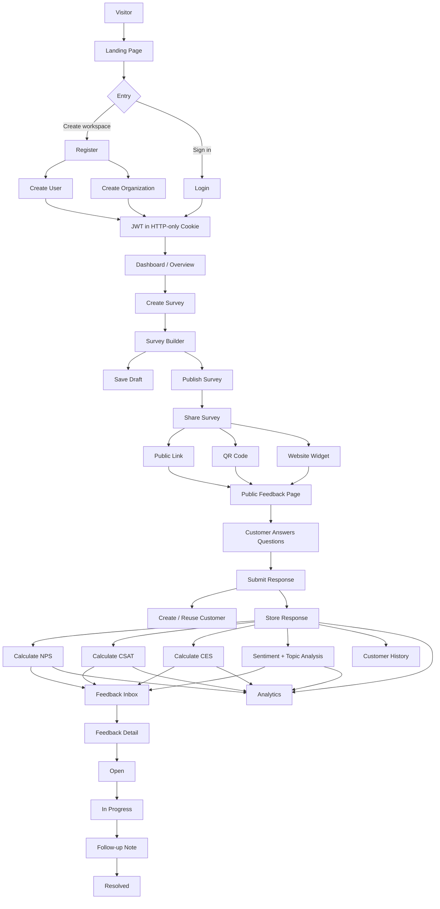

---

## Product Areas

| Area | Purpose |
|---|---|
| Landing | Public product introduction and entry point into Recoz |
| Authentication | Register, login, email verification, Google OAuth, refresh tokens, password recovery |
| Dashboard | Fast overview of feedback volume and customer experience metrics |
| Surveys | Create, edit, delete, publish, and share surveys |
| Public Survey | Customer-facing dynamic feedback form |
| Feedback | Search, filter, inspect, update, and resolve customer feedback |
| Customers | View people who submitted feedback and their feedback history |
| Analytics | NPS, CSAT, CES, response volume, topics, and sentiment trends |
| Settings | Profile, organization, branding, and account security |

---

# Tech Stack

## Frontend

- React
- Vite
- JavaScript
- React Router
- TanStack Query
- Redux Toolkit
- Axios
- Tailwind CSS
- Recharts
- Lucide React

## Backend

- Node.js
- Express.js
- JavaScript
- MongoDB
- Mongoose
- JWT
- bcrypt
- Passport.js / Google OAuth
- Nodemailer / email service layer
- Zod-style request validation through project validators

## Architecture

- REST API
- Feature-based React frontend
- Layered Express backend
- Organization-scoped data access
- JWT authentication with cookies
- Server state handled by TanStack Query
- Lightweight global client state handled by Redux Toolkit

---

# Repository Structure

```text
Recoz-Feedback/
│
├── backend/
│   ├── public/
│   │
│   ├── src/
│   │   ├── config/
│   │   │   ├── cookie.js
│   │   │   ├── db.js
│   │   │   ├── env.js
│   │   │   └── passport.js
│   │   │
│   │   ├── controllers/
│   │   │   ├── analytics.controller.js
│   │   │   ├── auth.controller.js
│   │   │   ├── customer.controller.js
│   │   │   ├── response.controller.js
│   │   │   └── survey.controller.js
│   │   │
│   │   ├── middlewares/
│   │   │   ├── auth.middleware.js
│   │   │   ├── error.middleware.js
│   │   │   └── validate.middleware.js
│   │   │
│   │   ├── models/
│   │   │   ├── customer.model.js
│   │   │   ├── organization.model.js
│   │   │   ├── question.schema.js
│   │   │   ├── response.model.js
│   │   │   ├── survey.model.js
│   │   │   └── user.models.js
│   │   │
│   │   ├── routes/
│   │   │   ├── analytics.routes.js
│   │   │   ├── auth.routes.js
│   │   │   ├── customer.routes.js
│   │   │   ├── response.routes.js
│   │   │   └── survey.routes.js
│   │   │
│   │   ├── services/
│   │   │   ├── analytics.service.js
│   │   │   ├── auth.service.js
│   │   │   ├── customer.service.js
│   │   │   ├── email.service.js
│   │   │   ├── response.service.js
│   │   │   ├── sentiment.service.js
│   │   │   └── survey.service.js
│   │   │
│   │   ├── utils/
│   │   │   ├── ApiError.js
│   │   │   ├── asyncHandler.js
│   │   │   ├── calculateMetrics.js
│   │   │   ├── generateSlug.js
│   │   │   └── generateToken.js
│   │   │
│   │   ├── validators/
│   │   │   ├── auth.validator.js
│   │   │   ├── response.validator.js
│   │   │   └── survey.validator.js
│   │   │
│   │   ├── app.js
│   │   └── server.js
│   │
│   ├── .env.example
│   ├── package.json
│   └── .gitignore
│
├── frontend/
│   ├── config/
│   │   └── axiosInstance.jsx
│   │
│   ├── public/
│   │
│   ├── src/
│   │   ├── app/
│   │   │   ├── layout/
│   │   │   │   ├── AppLayout.jsx
│   │   │   │   ├── PublicLayout.jsx
│   │   │   │   └── RootLayout.jsx
│   │   │   ├── routes/
│   │   │   │   ├── ProtectedRoute.jsx
│   │   │   │   └── routes.jsx
│   │   │   └── store.jsx
│   │   │
│   │   ├── features/
│   │   │   ├── Landing/
│   │   │   ├── analytics/
│   │   │   ├── auth/
│   │   │   ├── customers/
│   │   │   ├── dashboard/
│   │   │   ├── feedback/
│   │   │   ├── setting/
│   │   │   └── surveys/
│   │   │
│   │   ├── global/
│   │   │   └── NotFound.jsx
│   │   │
│   │   ├── shared/
│   │   │   ├── components/
│   │   │   ├── hooks/
│   │   │   └── Card.jsx
│   │   │
│   │   └── main.jsx
│   │
│   ├── .env.example
│   ├── package.json
│   ├── tailwind.config.js
│   └── vite.config.js
│
└── README.md
```

> The structure above follows the supplied repository screenshots and the current route/controller/service layout. Folder internals not shown in the screenshots are intentionally kept at the level supported by the provided structure.

---

# Backend Architecture

Recoz uses a layered Express architecture:

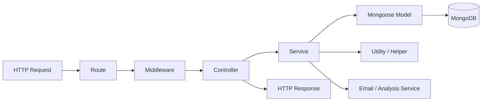

### Responsibilities

**Routes**
- Define HTTP methods and endpoint paths
- Attach authentication and validation middleware
- Keep endpoint wiring thin

**Middleware**
- Authenticate requests
- Validate request payloads
- Centralize error handling

**Controllers**
- Read request data
- Call the correct service
- Return a consistent response
- Avoid embedding heavy business logic

**Services**
- Contain business rules
- Orchestrate database operations
- Calculate experience metrics
- Handle survey and response workflows
- Process authentication and email flows

**Models**
- Define MongoDB schemas
- Store application data
- Provide the persistence boundary for services

---

# Data Model

Recoz keeps the MVP data model compact.

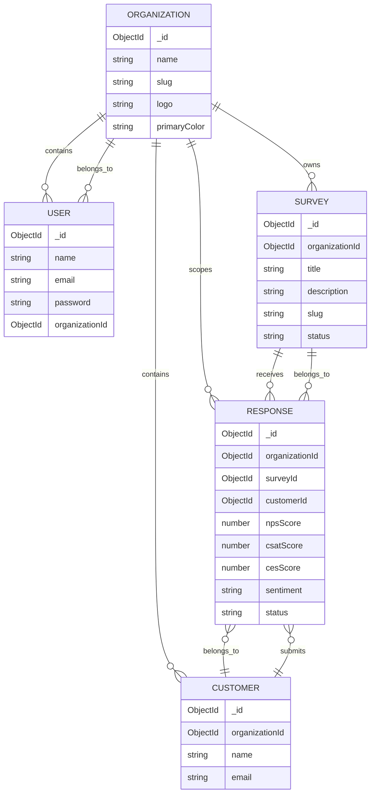

## Survey Question Mapping

Questions are embedded inside a survey. Each question has its own identifier.

```text
Survey
│
└── questions[]
      ├── _id: q1
      ├── _id: q2
      └── _id: q3

Response
│
└── answers[]
      ├── questionId: q1 → value: 4
      ├── questionId: q2 → value: 8
      └── questionId: q3 → value: "Delivery was slow"
```

This lets the response preserve a stable relationship between each answer and the exact survey question that produced it.

---

# Authentication & Account Flow

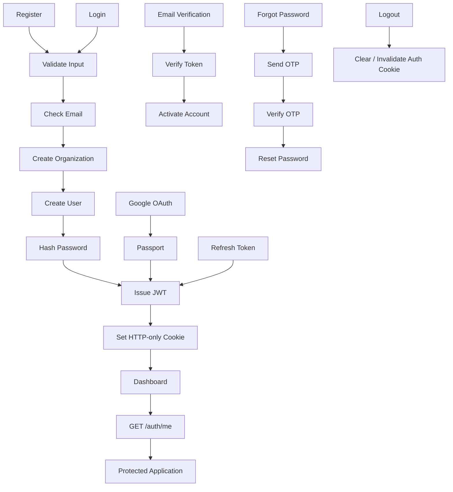

### Authentication capabilities

- Registration
- Email/password login
- Email verification
- Resend verification
- Forgot-password OTP
- Resend OTP
- Invalidate OTP
- Verify OTP
- Reset password
- JWT refresh
- Google OAuth
- Current-user lookup
- Logout
- Profile update
- Authenticated password change

---

# Frontend Routing & Access

```mermaid
flowchart TD
    A[/] --> B[Landing Page]
    C[/login] --> D[Public Auth]
    E[/register] --> D
    F[/verify-email] --> D
    G[/forgot-password] --> D

    D --> H{Authenticated?}
    H -->|Yes| I[/dashboard]
    H -->|No| J[Stay on Public Route]

    I --> K[AppLayout]
    K --> L[/surveys]
    K --> M[/surveys/create]
    K --> N[/surveys/publish]
    K --> O[/feedback]
    K --> P[/feedback/:feedbackId]
    K --> Q[/customers]
    K --> R[/customers/:customerId]
    K --> S[/analytics]
    K --> T[/settings]

    U[/f/:organizationSlug/:surveySlug] --> V[Public Customer Survey]
    V --> W[Submit Response]

    J --> X[Login / Register]
```

## Route categories

### Public application routes

```text
/
/login
/register
/verify-email
/forgot-password
/f/:organizationSlug/:surveySlug
```

### Protected application routes

```text
/dashboard
/surveys
/surveys/create
/surveys/publish
/feedback
/feedback/:feedbackId
/customers
/customers/:customerId
/analytics
/settings
```

`ProtectedRoute` wraps the authenticated application layout and prevents unauthenticated access to private pages.

---

# Page-by-Page Product Flow

## 1. Landing Page `/`

The public marketing front door of Recoz.

Purpose:
- Explain the product
- Show the collect → understand → act workflow
- Direct visitors to registration or login

Primary actions:
- Create workspace → `/register`
- Sign in → `/login`

---

## 2. Register `/register`

A single registration creates the business owner account and organization.

```text
Name
Organization name
Email
Password
        ↓
Create workspace
        ↓
User + Organization
        ↓
JWT Cookie
        ↓
Dashboard
```

No separate organization-creation screen is required for the current MVP flow.

---

## 3. Login `/login`

Business owner enters email and password.

Successful authentication:

```text
Credentials
   ↓
Passport / Auth Service
   ↓
JWT
   ↓
HTTP-only Cookie
   ↓
Dashboard
```

Google OAuth is also supported through Passport.

---

## 4. Verify Email `/verify-email`

Used after registration or when a verification email is issued.

Capabilities exposed by the backend:

- verify email token
- resend verification

---

## 5. Forgot Password `/forgot-password`

Password-recovery flow:

```text
Enter email
   ↓
Send OTP
   ↓
Verify OTP
   ↓
Set new password
   ↓
Return to login
```

The backend exposes separate endpoints for OTP send, resend, invalidation, verification, and password reset.

---

## 6. Dashboard `/dashboard`

The dashboard is the **Overview** page.

It gives a quick snapshot of:

- total responses
- NPS
- CSAT
- CES
- response volume
- sentiment mix
- top topics
- recent feedback

The dashboard is intentionally a snapshot, while `/analytics` is the deeper analytical view.

---

## 7. Surveys `/surveys`

Business owner can:

- view surveys
- create surveys
- edit surveys
- delete surveys
- publish surveys
- open sharing flow

Survey lifecycle:

```text
Draft
  ↓
Edit
  ↓
Publish
  ↓
Live
  ↓
Collect responses
```

---

## 8. Survey Builder `/surveys/create`

Dynamic survey creation workspace.

Typical question types supported by the product include:

- Rating
- NPS
- CSAT
- CES
- Short text
- Long text
- Multiple choice
- Yes / No

Every question carries its own ID so submitted answers can reference `questionId`.

---

## 9. Publish / Share `/surveys/publish`

After publishing a survey, the business can distribute it through:

### Link

A public URL customers can open directly.

### QR Code

The same public survey URL encoded into a QR code.

### Widget

A website embed that opens the same public survey experience.

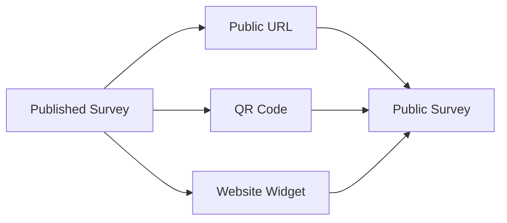

The important design choice is that **all three channels reuse the same dynamic public survey page** instead of creating separate survey implementations.

---

## 10. Public Survey `/f/:organizationSlug/:surveySlug`

This is the customer-facing page.

The page receives the organization and survey from URL parameters.

```text
URL params
   ↓
organizationSlug
surveySlug
   ↓
Fetch published survey
   ↓
Render survey.questions[]
   ↓
Customer answers
   ↓
Submit response
```

Customers do not need to create Recoz accounts.

### Dynamic question rendering

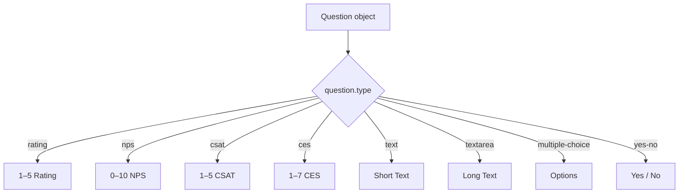

---

# Response Submission Flow

This is the core product transaction.

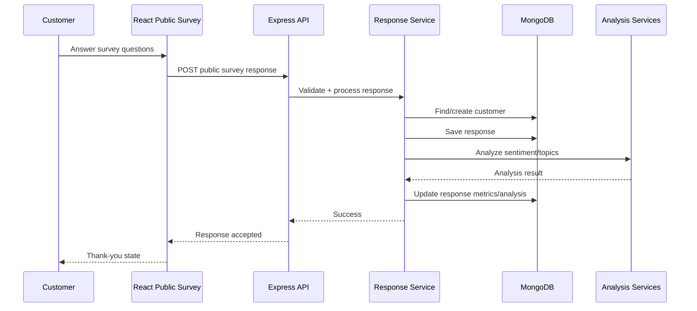

### Submitted answer shape

```json
{
  "customer": {
    "name": "Customer Name",
    "email": "customer@example.com"
  },
  "answers": [
    {
      "questionId": "question-id-1",
      "value": 5
    },
    {
      "questionId": "question-id-2",
      "value": 9
    },
    {
      "questionId": "question-id-3",
      "value": "Great product, but delivery was slow."
    }
  ]
}
```

---

# Experience Metrics

Recoz calculates metrics from submitted responses.

## CSAT

Measures satisfaction with the experience.

Typical representation:

```text
★★★★★
4 / 5
```

Satisfied responses are used to calculate the percentage score.

## NPS

Customer selects a score from 0–10.

```text
0–6   → Detractors
7–8   → Passives
9–10  → Promoters
```

Formula:

```text
NPS = Promoter % - Detractor %
```

## CES

**Customer Effort Score** measures how easy or difficult it was for the customer to complete a task or resolve an issue.

Example:

```text
1  2  3  4  5  6  7
Very difficult → Very easy
```

A customer selecting `6` can be displayed as:

```text
CUSTOMER EFFORT
6 / 7
```

---

# Feedback Inbox `/feedback`

The inbox converts raw responses into an operational queue.

Features:

- search by customer, email, text, or topic
- status filter
- sentiment filter
- source filter
- rating filter
- sorting
- pagination
- open feedback detail

Typical flow:

```text
All feedback
   ↓
Search / filter
   ↓
Open response
   ↓
Review answers
   ↓
Take action
```

---

# Feedback Detail `/feedback/:feedbackId`

Shows one response in full.

Includes:

- customer information
- NPS score
- CSAT score
- CES score
- submitted answers
- sentiment
- detected topics
- source
- status
- follow-up note

## Close-the-loop workflow

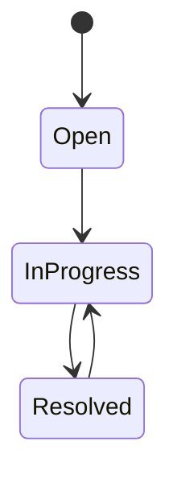

The owner can:

- move status to `In Progress`
- add an internal follow-up note
- mark feedback as `Resolved`

This gives Recoz an operational loop instead of stopping at data collection.

---

# Customers `/customers`

Lists people who have submitted feedback.

Typical fields:

- name
- email
- feedback count
- average rating
- last feedback date

Clicking a customer opens the detail page.

---

# Customer Detail `/customers/:customerId`

Provides customer-level context:

- customer identity
- number of feedback responses
- average rating
- first/creation date
- feedback history

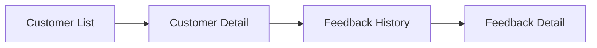

This connects a customer's historical responses back into the main feedback workflow.

---

# Analytics `/analytics`

The Analytics page turns stored responses into trends.

Main areas:

- total responses
- NPS
- CSAT
- CES
- response volume
- NPS breakdown
- top topics
- sentiment distribution
- selected time range

Supported ranges in the current UI design:

```text
7d
30d
90d
```

The analytics layer is intended to aggregate real response data rather than relying on hardcoded dashboard values.

---

# Analytics Data Flow

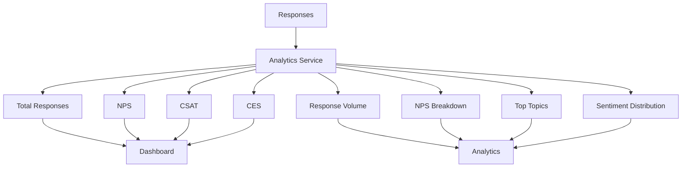

---

# Response Analysis

Recoz stores response-level analysis fields such as:

```text
sentiment
topics
```

A typical analysis pipeline is:

```text
Text answer
   ↓
Sentiment service
   ↓
positive / neutral / negative

Text answer
   ↓
Topic detection
   ↓
Delivery / Support / Product / Checkout / etc.
```

The current backend also has a dedicated `sentiment.service.js`, keeping analysis logic outside the controller layer.

This separation leaves room for swapping or extending the analysis implementation later without changing the response workflow.

---

# REST API

> Endpoint mount prefixes depend on `app.js`. The endpoint map below follows the current route definitions and the product's API naming convention.

## Authentication

| Method | Endpoint | Purpose | Access |
|---|---|---|---|
| POST | `/api/auth/register` | Create user + organization | Public |
| POST | `/api/auth/login` | Login | Public |
| POST | `/api/auth/verify-email` | Verify account email | Public |
| GET | `/api/auth/verify-email` | Verify account email through link | Public |
| POST | `/api/auth/resend-verification` | Resend verification | Public |
| POST | `/api/auth/forgot-password` | Start OTP password recovery | Public |
| POST | `/api/auth/resend-otp` | Resend reset OTP | Public |
| POST | `/api/auth/invalidate-otp` | Invalidate active OTP | Public |
| POST | `/api/auth/verify-otp` | Verify reset OTP | Public |
| POST | `/api/auth/reset-password` | Set new password | Public |
| POST | `/api/auth/refresh-token` | Refresh authentication token | Public/Token flow |
| POST | `/api/auth/refresh` | Alias for refresh | Public/Token flow |
| GET | `/api/auth/google` | Start Google OAuth | Public |
| GET | `/api/auth/google/callback` | Google OAuth callback | Public |
| GET | `/api/auth/me` | Get current user | Protected |
| POST | `/api/auth/logout` | Logout | Protected |
| PATCH | `/api/auth/update-profile` | Update profile | Protected |
| PATCH | `/api/auth/change-password` | Change current password | Protected |

## Surveys

| Method | Endpoint | Purpose | Access |
|---|---|---|---|
| GET | `/api/surveys/public/:organizationSlug/:surveySlug` | Load public survey | Public |
| POST | `/api/surveys` | Create survey | Protected |
| GET | `/api/surveys` | List surveys | Protected |
| GET | `/api/surveys/:id` | Get survey | Protected |
| PATCH | `/api/surveys/:id` | Update survey | Protected |
| DELETE | `/api/surveys/:id` | Delete survey | Protected |
| POST | `/api/surveys/:id/publish` | Publish survey | Protected |

## Responses / Feedback

| Method | Endpoint | Purpose | Access |
|---|---|---|---|
| POST | `/api/public/surveys/:organizationSlug/:surveySlug` | Submit public survey response | Public |
| GET | `/api/responses` | Get responses | Protected |
| GET | `/api/responses/:id` | Get one response | Protected |
| PATCH | `/api/responses/:id` | Update response status | Protected |

> The current response router defines the public path as `/public/surveys/:organizationSlug/:surveySlug`. The final prefix is determined by where `response.routes.js` is mounted in `app.js`.

## Customers

| Method | Endpoint | Purpose | Access |
|---|---|---|---|
| GET | `/api/customers` | List customers | Protected |
| GET | `/api/customers/:customerId` | Get customer details/history | Protected |

## Analytics

| Method | Endpoint | Purpose | Access |
|---|---|---|---|
| GET | `/api/analytics/overview` | Dashboard analytics overview | Protected |
| GET | `/api/analytics/trends` | Trend-oriented analytics | Protected |

---

# Frontend Route Map

The current React Router configuration defines these routes:

```text
PUBLIC
│
├── /
├── /login
├── /register
├── /verify-email
├── /forgot-password
└── /f/:organizationSlug/:surveySlug

PROTECTED
│
├── /dashboard
├── /settings
├── /surveys
├── /surveys/create
├── /surveys/publish
├── /feedback
├── /feedback/:feedbackId
├── /customers
├── /customers/:customerId
└── /analytics
```

A catch-all route renders the `NotFound` page.

---

# Frontend Feature Architecture

The frontend follows a feature-oriented structure rather than placing all application logic under generic components.

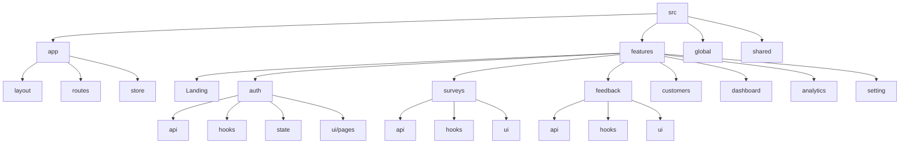

### State responsibilities

```text
TanStack Query
    ↓
Server state
- user
- surveys
- responses
- customers
- analytics
- organization

Redux Toolkit
    ↓
Client/global state
- UI preferences
- global interface state

React local state
    ↓
Local form and component state
- survey builder input
- OTP fields
- modal visibility
- temporary form values
```

---

# Protected Request Flow

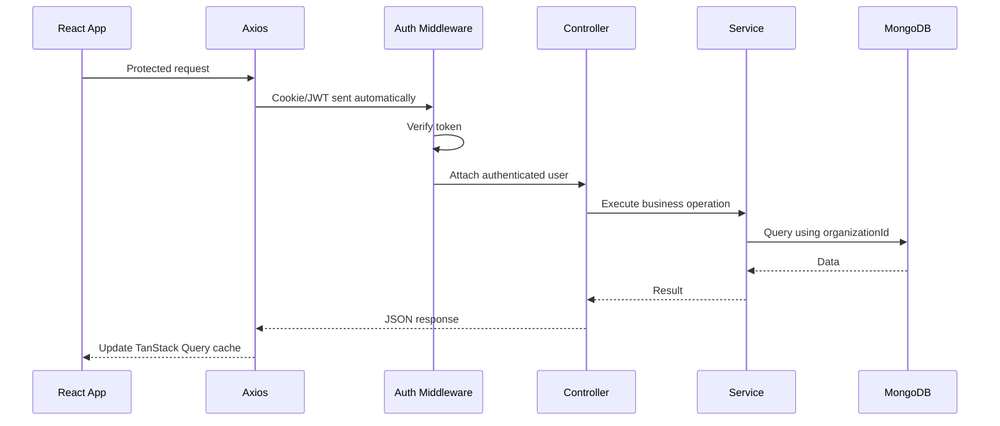

---

# Organization Isolation

Every business-owned resource is scoped to the authenticated user's organization.

The important security boundary is:

```text
JWT
 ↓
req.user.organizationId
 ↓
Database query
 ↓
Only that organization's data
```

Private queries should use the authenticated organization ID instead of trusting an `organizationId` supplied by the browser.

Example conceptual filter:

```js
{
  organizationId: req.user.organizationId
}
```

This applies to:

- surveys
- responses
- customers
- analytics
- organization settings

A resource ID alone must not be enough to access another organization's data.

---

# Share Channels

Recoz treats link, QR, and widget as distribution mechanisms for one survey.

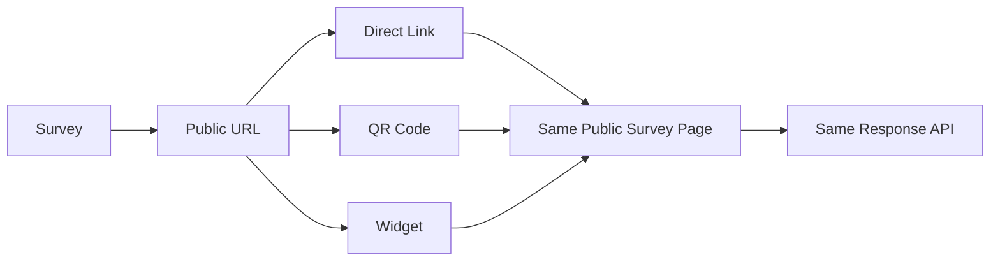

This keeps the product maintainable because there is only one customer-facing survey rendering system.

---

# Widget Concept

The website widget is a lightweight embed that points back to the public survey experience.

Conceptually:

```text
Business Website
      ↓
Recoz widget.js
      ↓
Feedback trigger
      ↓
Modal / iframe
      ↓
Public survey URL
      ↓
Customer submits
      ↓
Public response endpoint
```

The widget should reuse the public survey rather than duplicating survey question logic.

---

# QR Concept

The QR code is simply another representation of the same public survey URL.

```text
Published Survey
      ↓
https://domain/f/organization/survey
      ↓
QR Generator
      ↓
PNG / SVG QR
      ↓
Customer scans
      ↓
Public Survey Page
```

This means no separate QR-specific backend survey system is necessary.

---

# Survey Lifecycle

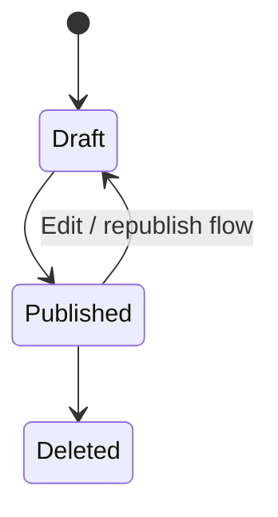

The exact deletion semantics are controlled by the current survey service implementation. Existing responses should be treated carefully when changing survey state because responses reference the survey.

---

# Feedback Lifecycle

```text
OPEN
  ↓
IN PROGRESS
  ↓
RESOLVED
```

The lifecycle is intentionally small for the MVP. The feedback detail page is where the business records the action taken and closes the loop.

---

# Analytics Architecture

The analytics service is the aggregation boundary for customer-experience reporting.

```mermaid
flowchart TD
    A[(MongoDB Responses)] --> B[Analytics Service]

    B --> C[Summary]
    B --> D[Response Volume]
    B --> E[NPS Breakdown]
    B --> F[Top Topics]
    B --> G[Sentiment]

    C --> H[/dashboard]
    C --> I[/analytics]
    D --> I
    E --> I
    F --> I
    G --> I
```

Typical analytics response structure:

```json
{
  "summary": {
    "totalResponses": 0,
    "nps": null,
    "csat": null,
    "ces": null
  },
  "responseVolume": [],
  "npsBreakdown": {},
  "topTopics": [],
  "sentiment": {}
}
```

Values should be derived from actual organization-scoped responses.

---

# Email & Security Flows

The backend contains a dedicated `email.service.js` and authentication routes for:

- verification email
- OTP password recovery
- OTP resend/invalidation
- reset password

This keeps email transport separate from controllers and authentication business logic.

The Google OAuth flow is handled through Passport configuration in `config/passport.js`.

---

# Environment Variables

Keep secrets outside the repository.

Typical backend environment variables:

```env
PORT=5000
MONGO_URI=
JWT_SECRET=
CLIENT_URL=http://localhost:5173
NODE_ENV=development
```

Typical frontend configuration:

```env
VITE_API_URL=http://localhost:5000/api
```

For deployment, use the platform's environment-variable manager instead of committing secrets.

---

# Local Development

## Backend

```bash
cd backend
npm install
npm run dev
```

If the project uses a production start command:

```bash
npm start
```

## Frontend

```bash
cd frontend
npm install
npm run dev
```

The frontend should run against the backend API through the configured Axios instance.

---

# Typical Development Sequence

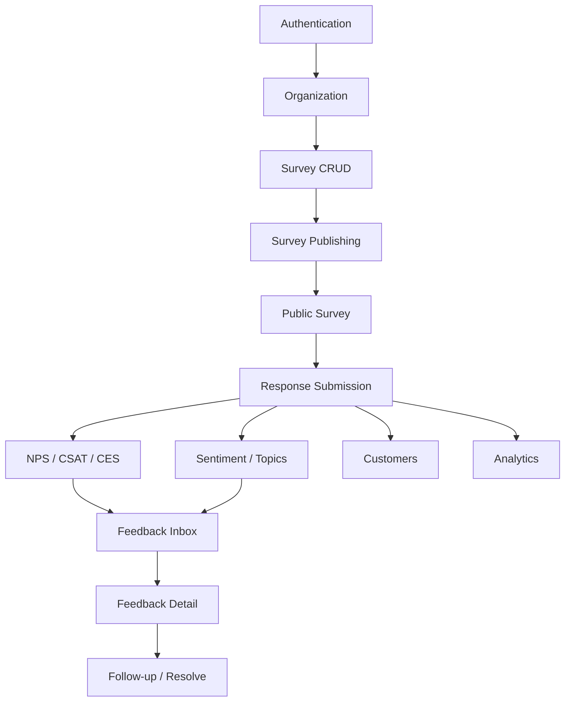

---

# API-to-Feature Mapping

```text
AUTH
├── register
├── login
├── email verification
├── Google OAuth
├── refresh token
├── me
├── logout
├── profile update
├── change password
└── forgot password / OTP

SURVEYS
├── create
├── list
├── get one
├── update
├── delete
└── publish

PUBLIC SURVEY
├── load survey
└── submit response

FEEDBACK
├── list
├── get one
└── update status

CUSTOMERS
├── list
└── detail + history

ANALYTICS
├── overview
└── trends
```

---

# Product Architecture at a Glance

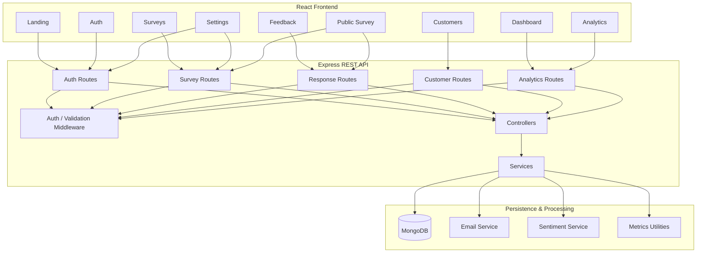

---

# Design & UX Principles

Recoz uses a premium light visual language across the marketing site, auth flow, dashboard, and product workspace.

### Brand palette

```text
#F62440  Primary accent
#FFE5BF  Soft peach
#FFF2DB  Warm cream
#FFFAF3  Main background
```

### Typography

- **Poppins** for headings and major visual hierarchy
- **Inter** for UI text, labels, forms, metadata, and body copy

### UX direction

- clean and spacious
- subtle borders and shadows
- restrained accent usage
- mobile-first public survey experience
- clear empty/loading/error states
- minimal but meaningful animations
- functional over decorative UI

---

# Security Notes

- JWT is kept in an HTTP-only cookie instead of browser local storage.
- Passwords are hashed before storage.
- Authentication middleware protects business-only routes.
- Organization ownership is checked before reading or updating private resources.
- Public survey routes do not require customer authentication.
- Password recovery uses an OTP/token workflow rather than trusting an email address alone.
- Secrets belong in environment variables, never in source code.

---

# What Makes the Project More Than a Survey Form

Recoz is not only a form builder.

The complete system is:

```text
CREATE
  ↓
COLLECT
  ↓
MEASURE
  ↓
UNDERSTAND
  ↓
FOLLOW UP
  ↓
RESOLVE
```

The survey is the entry point. The actual product is the workflow around the feedback after it is submitted.

---

# Current MVP Scope

Included:

- business authentication
- organization creation
- email verification
- Google OAuth
- password recovery with OTP
- survey CRUD
- dynamic survey questions
- survey publishing
- public customer survey
- customer records
- response storage
- NPS / CSAT / CES
- sentiment and topic analysis
- feedback inbox
- feedback status workflow
- customer history
- analytics dashboard
- QR sharing
- website widget sharing
- organization branding

Intentionally outside the current MVP scope:

- billing and subscriptions
- team/role management
- enterprise SSO
- CRM integrations
- SMS / WhatsApp messaging
- complex workflow automation
- advanced AI agents
- large-scale infrastructure such as Kafka or microservices

---

# End-to-End Example

A complete real-world journey looks like this:

```text
Business owner
    ↓
/register
    ↓
Create workspace
    ↓
User + Organization created
    ↓
Authenticated dashboard
    ↓
/surveys/create
    ↓
Create "Post Purchase Experience"
    ↓
Add CSAT + NPS + Text question
    ↓
Publish
    ↓
/surveys/publish
    ↓
Copy link / generate QR / install widget
    ↓
Customer opens public survey
    ↓
Customer answers questions
    ↓
POST response
    ↓
Create/reuse customer
    ↓
Store answers using questionId
    ↓
Calculate NPS / CSAT / CES
    ↓
Analyze sentiment + topics
    ↓
Feedback appears in /feedback
    ↓
Owner opens /feedback/:feedbackId
    ↓
Adds follow-up note
    ↓
Changes Open → In Progress
    ↓
Resolves feedback
    ↓
Customer history updates
    ↓
Analytics update
```

---

# Project Philosophy

Recoz is built around a simple idea:

> **Customer feedback is useful only when it can become a decision or an action.**

The architecture therefore follows the product workflow rather than creating isolated CRUD modules.

```text
Survey
  → Response
     → Metrics
     → Analysis
     → Feedback
        → Follow-up
        → Resolution
```

That relationship is the core of the entire system.

---

## License

This project is a personal project. Add your preferred license here if you decide to open-source it.
